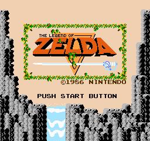

1.789773 MHz

1.789773 * 10 ^ 6

1789773/60 = 29829.55
29829.55/244 = 12225.2254098361
1789773/44100 = 40.5844217687

1000/60 = 16.6666666667

# Benchmark
```
for v in 3.10 3.11 3.12 3.13 3.14 pypy@3.11; do echo $v && PYTHONPATH=".:src" $(uv python find $v) benchmark.py; done
```
## Results

`3.14` is winning.

```
3.10
--------------------------------------------------------
CPU Execution Time           : 10.676125 ms
NES CPU Cycles               : 26553
Real time / NES CPU Cycles   : 0.000402 ms
--------------------------------------------------------
3.11
--------------------------------------------------------
CPU Execution Time           : 5.521625 ms
NES CPU Cycles               : 26553
Real time / NES CPU Cycles   : 0.000208 ms
--------------------------------------------------------
3.12
--------------------------------------------------------
CPU Execution Time           : 5.869083 ms
NES CPU Cycles               : 26553
Real time / NES CPU Cycles   : 0.000221 ms
--------------------------------------------------------
3.13
--------------------------------------------------------
CPU Execution Time           : 5.673792 ms
NES CPU Cycles               : 26553
Real time / NES CPU Cycles   : 0.000214 ms
--------------------------------------------------------
3.14
--------------------------------------------------------
CPU Execution Time           : 5.190459 ms
NES CPU Cycles               : 26553
Real time / NES CPU Cycles   : 0.000195 ms
--------------------------------------------------------
pypy@3.11
--------------------------------------------------------
CPU Execution Time           : 32.284958 ms
NES CPU Cycles               : 26553
Real time / NES CPU Cycles   : 0.001216 ms
--------------------------------------------------------
```

## Dumping a frame

The current background renderer can produce a PPM preview from iNES
ROMs:

```sh
uv run paines dump-frame path/to/game.nes --output frame.ppm
```

The command skips four startup frames by default; use `--skip-frames 0` to
capture the first frame or provide a different non-negative count. The renderer
currently draws backgrounds and basic sprites, without scanline-accurate
effects, so this is an early preview rather than a complete game image.

## Playing a ROM

ROMs using mappers 0 (NROM), 1 (MMC1), 2 (UxROM), 3 (CNROM) and 4 (MMC3) can be played in a window (requires the optional `pygame-ce` dependency):

```sh
uv run --extra play paines play path/to/game.nes --scale 3
```

Controls: arrows = D-pad, `X` = A, `Z` = B, `Enter` = Start, `Right Shift` = Select, `Esc` = quit.

Audio is played through pygame's mixer (44.1 kHz mono). The APU (`src/paines/apu/`)
implements both pulse channels (envelope, sweep, length), triangle, noise, DMC, the
frame counter with its IRQ, and the nonlinear mixer. Channels are advanced
arithmetically right before each output sample rather than every CPU cycle. If no audio
device is available, the game runs silently.

## Half human, half AI

This project is a deliberate mix. The CPU was written by hand, one opcode at a time, and
verified against `nestest`. Everything that makes it a *console* (picture, sound, input,
mappers, window) was built later with GitHub Copilot, with me steering, reviewing and testing.

By surviving lines of Python (`git blame`; "AI" = commits co-authored by Copilot):

| Component | What it does | Human | AI |
|---|---|---|---|
| `cpu/` | 6502 core, all official opcodes, NMI/IRQ, nestest trace | 97% | 3% |
| `ram/`, `types.py` | work RAM and shared types | ~90% | ~10% |
| `bus/` | CPU memory map, controllers, OAM DMA | 30% | 70% |
| `cartridge/` | iNES loader, NROM/MMC1/UxROM/CNROM/MMC3 mappers | 16% | 84% |
| `ppu/` | scrolling, backgrounds, sprites, event-driven timing | 0% | 100% |
| `apu/` | pulse, triangle, noise, DMC, frame counter, mixer | 0% | 100% |
| `frontend.py` | pygame window, input polling, audio buffer | 0% | 100% |
| `tests/` | unit tests per component | 50% | 50% |
| **Total** | | **~48%** | **~52%** |

Roughly: **I wrote the CPU, Copilot wrote the rest**, and the tests are split down the middle.
Line counts are only a rough measure. Surviving lines favor whoever touched a file last, and
"AI" lines still went through my prompts, review and play-testing.

## Tracking what works

`capture_frames.py` runs every supported ROM in the given folders (tapping Start every 50 frames),
and saves the last frame of each to `frames/` as a PNG:

```sh
uv run python capture_frames.py "path/to/roms" tests/cartridge/zelda
```

| | | |
|---|---|---|
| .png>) | .png>) | .png>) |
| .png>) | .png>) |  |

The `dump-frame` command writes a PPM, which most viewers and GitHub can't display inline;
convert it with `write_png` from `paines.ppu.frame` if needed.
